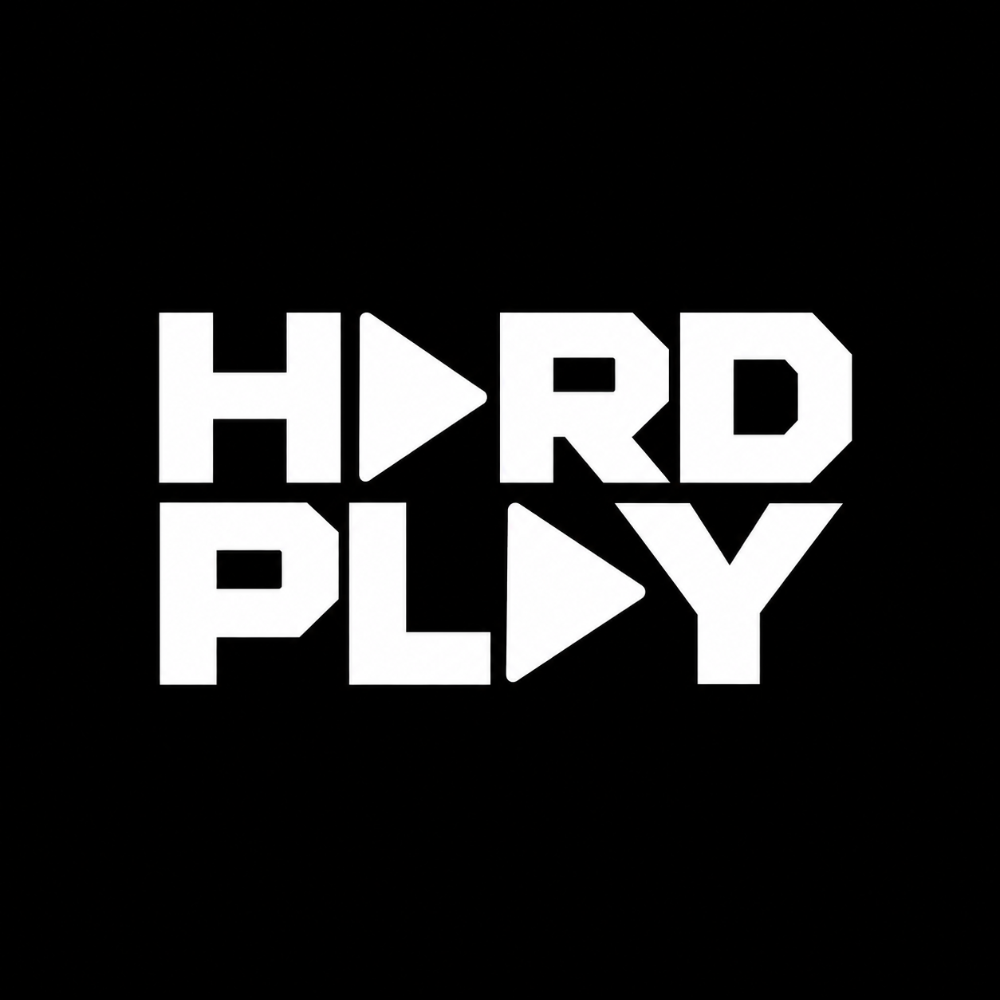

# Hard Play



**A lightweight audio player for macOS, built for running a set while working in other apps.** Developed by RavitzLab. Play local files, prepare transitions and control the same queue from Main, Mini, Nano or the menu bar.

[Download for Mac](https://github.com/RavitzLab/HARDPLAY/releases/latest) · [Установка](docs/INSTALL.ru.md) · [Руководство на русском](docs/USER_GUIDE.ru.md) · [Changes](CHANGELOG.md)

## Install and start

1. Download the DMG or ZIP from **Releases**. Published packages require **macOS 14+ and Apple Silicon**. Intel packages are not provided; a source build on Intel has not been validated.
2. Open the DMG and drag **HARDPLAY.app** into **Applications**, or extract the ZIP and move the app there.
3. Open Hard Play. Drag audio from Finder into the player or its playlist. Selecting a row does **not** start playback: press its Play button.
4. Open **PATCH → Audio** and check **Main Output** before sending audio to your system. Configure a separate **Preview Output** if you want to audition through headphones or another device.
5. Save your queue through **Playlist Actions → Save Playlist**. A playlist contains file references and settings, **not the audio files**.

The app is ad-hoc signed and **not notarized by Apple**. If macOS blocks its first launch, verify the source and use the normal **System Settings → Privacy & Security → Open Anyway** flow. Do not disable Gatekeeper. Local playback does not need an internet connection. Supported codecs depend on macOS; the app does not promise every audio format.

**Versions:** current source is **0.36.1**. Installers are published separately under Releases; check the version before downloading. Source changes do not deploy the web edition.

## What you can do

| Area | Controls and behavior |
| --- | --- |
| Playback | Previous, Play/Pause, Next, master volume, Next/Auto Stop, Repeat One/All/Off and Shuffle. |
| Transitions | Crossfade duration from **0 to 30 seconds**, in 0.1-second steps. Default for an unconfigured transition: **2 seconds**. Apply to the current transition or the entire playlist. |
| Media import | Drop audio or video. Extract the first audio stream using Auto, AAC or WAV; originals stay unchanged. Optional locally installed FFmpeg provides extra codec decoding. See the user guide for limits. |
| Queue | Show in Finder from track actions; add/drop files, reorder by the handle, duplicate, rename, sort, remove and save named sets. Removing an entry does not delete its source audio. |
| Waveforms | Hover to inspect time. Unlock the small seek padlock for one seek gesture; it relocks on release or after an unused unlock expires. NEXT is a preview of the queued track; use **Start at…** in its playlist actions to set a start point. |
| Editing | Quick Edit offers waveform zoom, in/out points, split, multiple selected regions, joining and edge-silence detection. Save a new WAV as a copy or replace the queue entry; the original file stays unchanged. |
| Audio | Independent Main and Preview output selection. Concurrent audition requires separate, available outputs. |
| Windows | Main, Mini, Nano and menu-bar controller share one player. Closing a player window keeps the app running in the menu bar; **Command-Q quits**. Settings have **Back to Player**; closing them returns to the originating player. |
| Appearance | Tape Blue, FOH, Tape Black, Stage, Cables, Minimal, Mono Console, Crew Tape and White. Save named custom themes with colors, opacity and control sizes under **My Themes**. |
| Protection | The control lock protects live operation. Hold its unlock control for **1.5 seconds**. Seek locks and playlist/setup protection are separate controls. |

**PATCH → App** opens Themes & Appearance, Keyboard / MIDI, Timecode & Backup and Web Viewer. Hover hints can be enabled with the question-mark button or in PATCH. [The user guide](docs/USER_GUIDE.ru.md) explains common workflows and shortcuts.

## Additional tools and limits

- **Quick Edit:** [editing guide](docs/QUICK-EDIT.ru.md). It edits regions from one source file; it is not a multitrack DAW.
- **Web Viewer:** [local read-only playlist display](docs/WEB-VIEWER.ru.md). It does not stream audio or offer remote transport control.
- **Backup set sync:** [connect two Macs and choose the source](docs/BACKUP-SETUP.ru.md). Push or pull playlist metadata, matching locally loaded files by SHA-256. Review before applying; Undo restores the destination. The A/B indicator next to PATCH shows connection and set matching. Enable **Linked Playback** on both paused Macs to share Play/Pause, Next/Previous and seeks, with Primary A driving track choice and position updates. This is LAN control, not sample-accurate clock synchronization; automatic failover and hardware timecode are not implemented. [Future stage plan](docs/TIMECODE-BACKUP-PLAN.ru.md).
- **Offline web player:** a separate edition in [`web/`](web/README.md). Its features and browser storage differ from the Mac app. It does not automatically share the native audio library.

Hardware MIDI, physical audio routing, cross-computer operation and live PA use need testing with the intended equipment. See [validation status](VALIDATION.md).

## Build the Mac app

Requires macOS 14+, **Swift 6 or newer** (Xcode / Command Line Tools), Python 3 and standard macOS tools. There are no third-party Swift dependencies. Node.js 22+ is needed only for the web edition.

```sh
git clone https://github.com/RavitzLab/HARDPLAY.git
cd HARDPLAY
zsh scripts/build.sh
open build/HARDPLAY.app
```

The build registers bundled fonts, generates the app icon, signs the app locally and runs model, queue and style checks. It does not install into Applications, upload anything or publish a release.

```sh
# Optional checks
build/HARDPLAY.app/Contents/MacOS/HARDPLAY --workspace-test
build/HARDPLAY.app/Contents/MacOS/HARDPLAY --playlist-test
build/HARDPLAY.app/Contents/MacOS/HARDPLAY --clip-test
build/HARDPLAY.app/Contents/MacOS/HARDPLAY --waveform-test
build/HARDPLAY.app/Contents/MacOS/HARDPLAY --backup-test
build/HARDPLAY.app/Contents/MacOS/HARDPLAY --set-sync-test
build/HARDPLAY.app/Contents/MacOS/HARDPLAY --linked-playback-test

# Create DMG, ZIP and SHA-256 files in build/release/
zsh scripts/release.sh
```

Audio and network checks can require macOS permissions and an unrestricted local environment. Tests use generated fixtures; do not add personal music to the repository. Packaging does not notarize the app or publish the generated files.

## Repository contents

- `Sources/` — native player, editing tools and regression checks.
- `web/` — browser player, build scripts and tests.
- `assets/` — the shipped logo and bundled fonts with their license notices.
- `docs/` — installation, operation and feature-specific guides.
- `scripts/` — build, packaging, source export and repository audit.
- `.github/workflows/` — CI verification.

Build output, caches, personal sets, audio, credentials, hosting identities and unused design drafts are excluded. See [repository hygiene](docs/REPOSITORY.md). Font license notices are retained in `assets/fonts/` and `web/public/font-license.txt`. No general open-source license is currently granted for the application code; public source visibility alone does not grant redistribution rights.

Release maintainers: a main-branch commit containing `[release]` (or a manual **Publish Mac Release** run) builds and tests the current version, then publishes its DMG, ZIP and checksums using `docs/RELEASE-<version>.md`. Existing releases are never overwritten.
