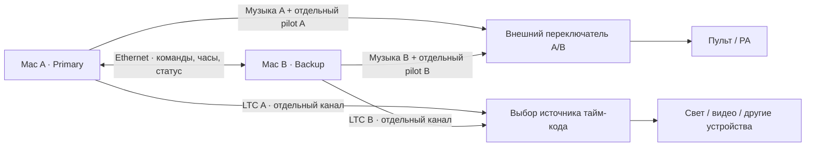

# HARDPLAY — план Timecode & Backup

Дата: 22 октября 2026. Статус: поэтапная реализация. Первый этап подготовки пары и проверки сетов добавлен в локальную версию 0.17.0; совместный запуск, тайм-код и автоматическое переключение ещё не реализованы. [Инструкция первого этапа](BACKUP-SETUP.ru.md).

Оборудование пока не выбрано (подтверждено пользователем); аппаратные параметры остаются настраиваемыми.

## Что получит пользователь

В Settings появится отдельное окно **Timecode & Backup**. Основной плеер останется виден. Настройка резервирования займёт три шага: **Connect → Check Set → Arm**. На основном экране будет одна компактная строка состояния и кнопка **Take Backup**. Подробные параметры и журнал останутся в настройках.

Исходное предположение: два Mac с нативным HARDPLAY, проводная локальная сеть, независимые аудиовыходы. Интернет для работы пары не нужен. Веб-версия сможет готовить сет; сценическое резервирование сначала реализуем в нативной версии.

## Как это будет работать

Оба компьютера заранее получают один сет и локальные копии всех файлов. Они воспроизводят его параллельно. В зал поступает только выбранный выход A или B. Резерв уже играет в нужном месте, поэтому при отказе основного не требуется заново открывать файл и искать позицию.

Выбор звука и тайм-кода должен быть согласован. Нельзя одновременно складывать два LTC-сигнала или два музыкальных выхода в один. Схему переключения LTC проверим с конкретным принимающим оборудованием: краткий разрыв и повтор кадра разные устройства обрабатывают по-разному.

### 1. Подключить резерв без ручной настройки адресов

- HARDPLAY обнаруживает другой экземпляр в локальной сети. На втором Mac подтверждается короткий код пары; случайное приложение в сети не получает управление.
- Выбираются роли **Primary A** и **Backup B**, аудиоустройства и выходы. Резерв сохраняет возможность продолжать текущий сет самостоятельно после потери A.
- Подключённый резерв ещё не означает готовность к переключению. Готовность включается только отдельным **Arm Backup** после проверки.

### 2. Проверить одинаковость сета одной кнопкой

**Check Set** сравнивает версию сета, порядок и ID пунктов, контрольные суммы аудио, длительности/обрезки, стартовые позиции, переходы 0/3/6 s и режимы остановки. Дубликаты одного файла остаются отдельными пунктами. Пути на двух Mac могут различаться.

При несовпадении показываем конкретно: «Track 07 — different file» или «Track 12 — missing». Дадим **Export Backup Package**: сет, manifest и используемое аудио в одном переносимом пакете. Копирование файлов — при подготовке, не во время шоу. Проверка также включает доступность декодирования, свободное место и маршрутизацию выходов.

Вооружённый сет блокирует структурные изменения. Для правки: **Disarm → Edit → Check → Arm**. Переименование для экрана можно разрешить отдельно, если оно не меняет исполнение.

### 3. Запускать оба компьютера одной кнопкой

Обычная Play планирует запуск A и B на согласованный момент немного в будущем. Оба заранее открывают и подготавливают аудио, подтверждают готовность. Если один не готов, совместный старт не выполняется; оператор видит причину и может явно выбрать запуск только A.

Команды Play, Pause, Next, Restart и Seek получают номер, подтверждение и защиту от повторного исполнения. На резерв передаётся реальная цель: ID пункта, позиция, переход и момент исполнения. Shuffle либо отключён в этом режиме, либо его выбор делает A и передаёт B — независимой случайной очереди быть не должно.

Согласуем монотонные часы, измеряем задержку/разброс сети и фактическое расхождение дек. Позднюю команду не исполняем как своевременную. В вооружённом режиме команда от оператора B проходит через единый источник управления; при потере связи B продолжает подтверждённый сценарий, а новый источник управления назначается явно.

## Тайм-код для других устройств

В окне настроек: **Off / Send / Follow**, тип сигнала, устройство/порт, FPS, начальный адрес и preroll. Реализация по этапам: сначала **Send LTC**, затем **Send MTC**, позже **Follow** внешнего LTC/MTC. LTC передаётся по отдельному аудиоканалу, MTC — через MIDI. Получатель должен поддерживать выбранный протокол; один тайм-код не заменяет команды конкретного устройства. [Документация QLab о LTC/MTC](https://qlab.app/docs/v5/networking/using-timecode/).

Для первой версии предлагаю **Set Timeline**: рассчитанная временная шкала всего сета, включая перекрытия crossfade. LTC идёт от общей шкалы и не перескакивает при штатном переходе на следующий трек. Номер трека, его локальное время и адрес TC показываются отдельно. Автостоп ставит шкалу на паузу; следующий старт продолжает её. Политика остановки получателя проверяется при настройке.

Свободные переходы, петли и перемотка могут менять адрес TC и повторно запускать внешние события. Поэтому в режиме Show такие операции защищены подтверждением; в Rehearsal разрешены. Отдельный будущий режим **Track Cues** даст каждому треку свой адрес TC для шоу со свободным порядком. Его не будем смешивать с непрерывной шкалой неявно.

FPS согласуется с устройствами, а не выбирается автоматически «по умолчанию навсегда». Предусмотрим стартовый адрес, например `01:00:00:00`, и настраиваемый preroll. LTC не маршрутизируется в музыкальный мастер или колонки. Для MTC по умолчанию предпочитаем физический MIDI-порт. Приёмникам может требоваться время на захват, а сетевой MTC чувствителен к задержкам. [Настройки и ограничения тайм-кода в QLab](https://qlab.app/docs/v5/networking/timecode-cues/).

**Тайм-код обозначает позицию; он сам по себе не синхронизирует аудиосэмплы двух интерфейсов.** Для долгого точного параллельного воспроизведения закладываем общий источник аудиочастоты, например совместимые интерфейсы с word clock. Фактическую точность измеряем на выбранном комплекте оборудования. [Об аудиочасах и дрейфе](https://qlab.app/docs/v5/networking/timecode-cues/).

## Определение отказа и переключение

Приложение не должно рассчитывать, что упавший процесс успеет отправить сообщение о собственном падении. Второй компьютер и внешний переключатель наблюдают за ним независимо.

| Событие | Реакция |
| --- | --- |
| A перестал отвечать по сети | Предупреждение; B продолжает. Сама потеря сети не переключает звук |
| На A остановился аудиодвижок или исчез интерфейс | Ошибка готовности; прекращение pilot, если движок ещё способен это сделать; внешний контроль сигнала |
| Пропал контрольный сигнал A | Переключение внешним A/B, если включён и проверен Auto Backup |
| В композиции тишина или оператор нажал Pause | Не считать аварией; pilot и штатный режим ожидания определены отдельно |
| A вернулся после отказа | Остаёмся на B. Проверка и возврат на A только вручную |
| B не готов | Явное «Backup not ready»; автоматический сценарий считается невооружённым |

**Heartbeat** проверяет процесс и связь; **Audio Health** — продвижение аудиосэмплов, ошибки декодирования и состояние устройства. Контрольный pilot генерируется в пути аудиодвижка и выводится отдельным каналом. Непрерывный тон доказывает наличие сигнала, но не гарантирует правильность музыки: зависание UI, зацикленный буфер и неверная позиция требуют отдельных проверок.

Начальный параметр для стенда: heartbeat 10 раз/с и предупреждение через 0,5–1 с без ответа. Это предлагаемые настройки диагностики, не обещанная скорость переключения. Аудиопереключение имеет собственный порог, зависящий от оборудования.

Для автоматического переключения при полном отказе Mac нужен независимый аппаратный A/B. Например, семейство Radial SW8 умеет следить за контрольным сигналом и выбирать резерв при его исчезновении; совместимость каналов, ручного управления и конкретного режима проверим до выбора устройства. Покупку конкретной модели этот план не предполагает. [Официальное описание SW8](https://www.radialeng.com/product/SW8).

Программная кнопка **Take Backup** может управлять переключателем только при наличии поддерживаемого интерфейса управления. При его отсутствии показываем статус и используем физическую кнопку A/B. Автоматический возврат на A отключён на уровне всей системы, включая аппаратную политику; если устройство этого не поддерживает, выбираем другую схему управления.

## Интерфейс без перегрузки

В основном окне: `A · PRIMARY   B · READY   Δ … ms   TC …`. Состояния подписаны словами, а не только цветом. Если нет измерения, показываем `Δ —`, а не выдуманную точность.

В Settings → Timecode & Backup:

1. **Connect:** другой Mac, роль, сеть, выходы.
2. **Check Set:** список несовпадений и кнопка подготовки пакета.
3. **Arm:** готовность обоих выходов, тест ручного переключения, затем разрешение Auto Backup.

**Take Backup** — крупная отдельная кнопка с защитой от случайного нажатия, назначаемая на клавиатуру/MIDI. Журнал показывает причину и время смены источника. Подробный технический статус открывается по нажатию на строку; повседневный интерфейс не заполняем диагностикой.

## Порядок реализации

| Этап | Проверяемый результат |
| --- | --- |
| 1. Pair & Set Check | Два Mac видят друг друга, сверяют файлы и настройки; пакет переносится без облака |
| 2. Scheduled Playback | Детерминированный движок, совместный старт/пауза/переходы; ручной выбор A/B; измерение расхождения |
| 3. Timecode Send | LTC из той же временной основы, затем MTC; проверка с реальным светом/видео |
| 4. Hot Backup | Watchdog, pilot, аппаратный Auto Backup, проверка аварий и ручного возврата |
| 5. Follow & Track Cues | Следование внешнему TC, потеря/возврат сигнала, репетиционные переходы и адреса отдельных треков |

Сейчас нативный транспорт использует два `AVPlayer` для crossfade (`Sources/main.swift`); веб — медиаплееры браузера (`web/public/engine.mjs`). Это действующий транспорт, но измеренная синхронизация двух компьютеров в нём ещё не реализована. Перед сценическим режимом выделим общий `PlaybackEngine`, подготовку PCM, планирование по аудиочасам и независимую от UI диагностику. Тему, окна, плейлисты и привычные кнопки сохраняем. Реализацию AVAudioEngine/Core Audio сначала проверим отдельным стендом; браузер не объявляем равноценным аппаратному резерву.

## Как принимаем работу

- Разные файлы, порядок, fade или неподдерживаемый кодек блокируют Arm с точной причиной.
- Повторная доставка Play не перезапускает трек. Selection по-прежнему не запускает звук.
- Два часа непрерывной работы: записываем оба аудиовыхода и измеряем стартовый сдвиг, дрейф и переходы. Порог приёмки определяем до реализации под задачу и оборудование.
- Принудительное завершение A, потеря его питания/USB-аудио, зависание UI, остановка движка и разрыв Ethernet испытываются отдельно.
- Разрыв сети не создаёт самовольного переключения и двух управляющих источников. B продолжает уже согласованный сет без облака.
- Проверяем тишину, обычную паузу, автостоп, crossfade, последние секунды, конец очереди и перезапуск A после аварии.
- Принимающее устройство реально следует LTC/MTC; проверяем FPS, preroll, seek и смену TC-источника.
- Записываем слышимый разрыв и поведение внешних устройств при переключении. «Без слышимого разрыва» обещаем только после измерений, не по наличию кнопки Backup.

Перед аппаратным этапом понадобится список аудиоинтерфейсов, внешних устройств/протоколов, количество выходов и требуемая точность. Для подготовки первых двух этапов это не мешает: архитектура уже предусматривает эти параметры.
